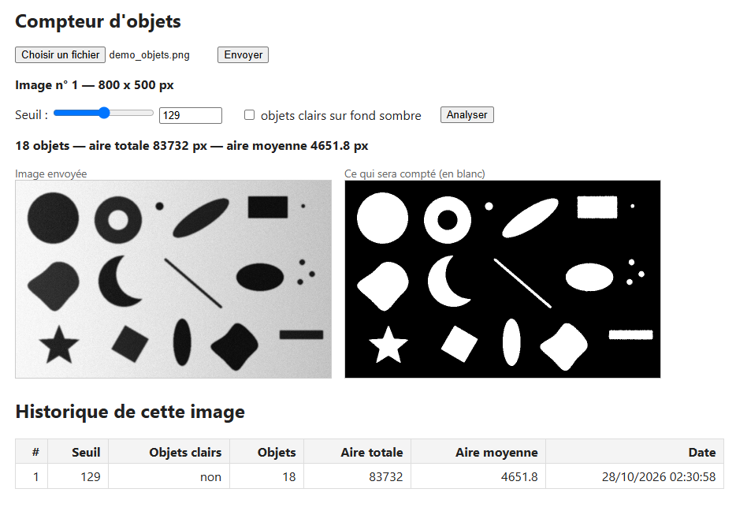
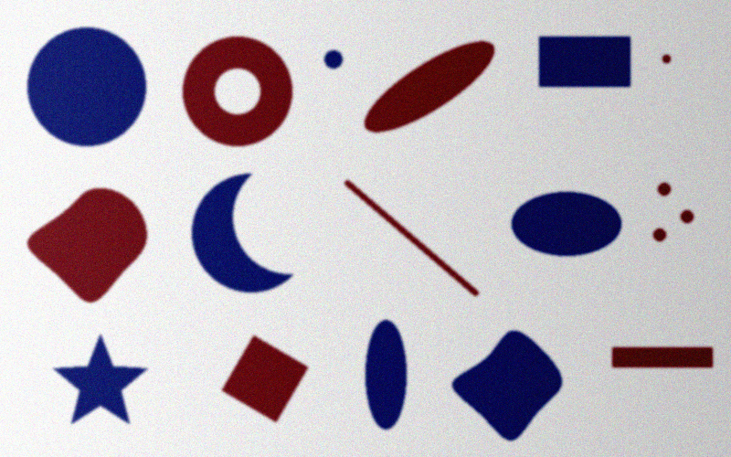
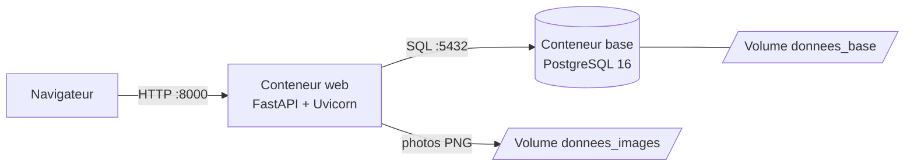
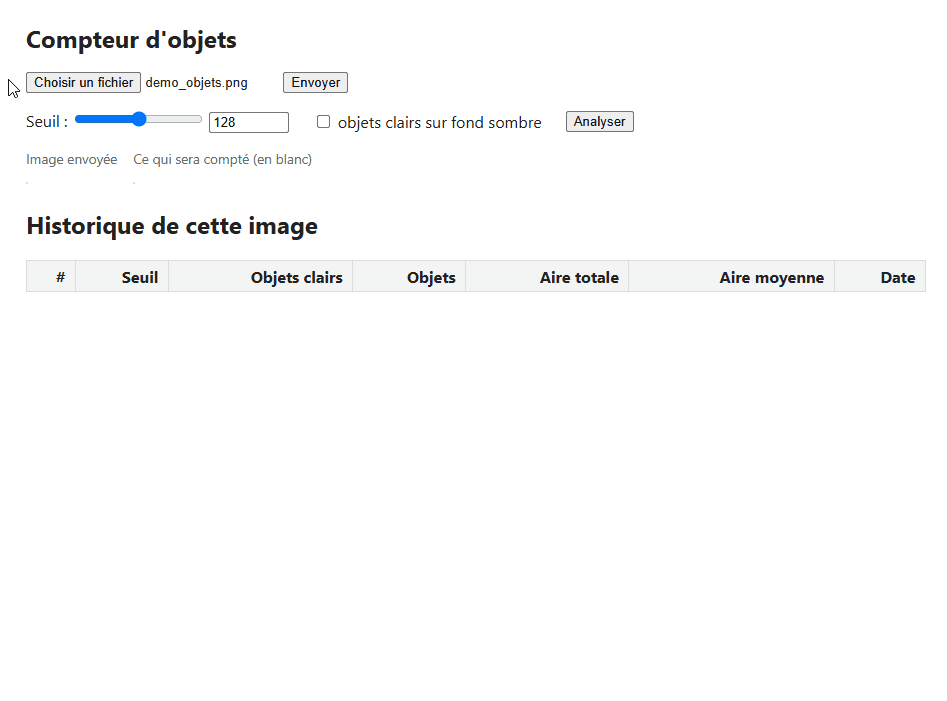

# Compteur d'objets

Service web qui compte les objets sur une photo : on envoie une image, on règle un seuil
en voyant le résultat en direct, et le service compte les objets et mesure leur surface.

Au-delà de cette fonctionnalité, l'essentiel du travail porte sur la construction d'un
service web complet : une API documentée, une base de données, une page web, des
conteneurs, des tests automatisés et une intégration continue qui refait le parcours
complet d'un utilisateur à chaque modification.

**Back-end** : Python 3.13 · FastAPI (API REST) · PostgreSQL 16  
**Front-end** : HTML · CSS · JavaScript  
**Outillage** : Docker Compose · pytest · GitHub Actions

[](https://github.com/raphollier/compteur-objets/actions/workflows/tests.yml)



## Pourquoi ce projet

Projet personnel d'apprentissage, pour pratiquer de bout en bout ce qu'on attend d'un
service web.

## Lancer le projet

Prérequis :

- [Docker](https://docs.docker.com/get-docker/) avec Docker Compose (inclus dans Docker
  Desktop sous Windows et Mac ; sous Linux, Docker Engine et le module `docker compose`) ;
- Git, pour récupérer le dépôt (ou le bouton **Code → Download ZIP** de GitHub) ;
- les ports 8000 et 5432 libres sur la machine.

Python n'est pas nécessaire : il est inclus dans l'image Docker.

```bash
git clone https://github.com/raphollier/compteur-objets.git
cd compteur-objets
docker compose up --build
```

Le premier lancement télécharge les images de base et les bibliothèques : compter
quelques minutes.

Puis ouvrir http://127.0.0.1:8000. La documentation interactive de l'API est sur
http://127.0.0.1:8000/docs.

- Arrêter : `Ctrl+C`, ou `docker compose down` (les données sont conservées).
- Tout effacer (base et photos) : `docker compose down -v`.
- Si un PostgreSQL tourne déjà sur la machine, le port 5432 est occupé et la base ne
  démarre pas. Il suffit de remplacer, dans `compose.yaml`, `127.0.0.1:5432:5432` par
  `127.0.0.1:5433:5432` : ce port ne sert qu'au développement.

### Une image pour essayer

[`docs/demo_objets.png`](docs/demo_objets.png) contient **18 objets** de formes et de tailles
variées. Ils sont en couleur, sur un fond éclairé de façon inégale et bruité. Le service en compte
**18** pour un seuil autour de 128. En poussant le seuil vers 190, on voit le fond sombre
de droite envahir le masque.



## Comment ça marche



1. **Envoi** : la photo (formats courants : JPEG, PNG, TIFF…, 10 Mo maximum) est décodée,
   remise à l'endroit, convertie en niveaux de gris et réduite à 1000 px maximum. Elle
   est enregistrée sous un nom aléatoire, et sa référence en base.
2. **Réglage du seuil** : au curseur ou au clavier. La page affiche en direct le masque
   binaire (en blanc, ce qui sera compté comme objet). Une case permet de compter des
   objets clairs sur un fond sombre.

   

3. **Analyse** : chaque pixel est classé objet ou fond selon le seuil, puis les pixels
   objets qui se touchent, y compris par un coin (8-connexité), sont regroupés par un
   parcours en largeur. Chaque groupe est un objet. Le résultat (nombre, aire totale,
   aire moyenne) est enregistré dans l'historique de l'image.

### L'API

| Méthode | Route | Rôle |
|---|---|---|
| `GET` | `/sante` | Vérifier que le service répond |
| `POST` | `/images` | Envoyer une photo (formulaire, champ `fichier`) |
| `GET` | `/images/{id}/fichier` | Récupérer la photo préparée (PNG) |
| `GET` | `/images/{id}/masque?seuil=…&objets_clairs=…` | Aperçu du masque binaire (PNG) |
| `POST` | `/images/{id}/analyses` | Lancer une analyse : `{"seuil": 0-255, "objets_clairs": false}` |
| `GET` | `/images/{id}/analyses` | Historique des analyses d'une image |
| `GET` | `/analyses?limit=…&offset=…` | Toutes les analyses, les plus récentes d'abord |

### Organisation du code

| Fichier | Rôle |
|---|---|
| [`app/analyse.py`](app/analyse.py) | L'algorithme : masque et comptage des objets |
| [`app/main.py`](app/main.py) | Les routes HTTP et les modèles de données |
| [`app/images.py`](app/images.py) | La préparation des photos |
| [`app/base.py`](app/base.py) | Les requêtes SQL |
| [`static/index.html`](static/index.html) | La page web |
| [`db/schema.sql`](db/schema.sql) | Les tables de la base |
| [`tests/`](tests/) | Les tests unitaires et d'intégration |
| [`Dockerfile`](Dockerfile), [`compose.yaml`](compose.yaml) | L'image du service et l'assemblage des conteneurs |
| [`.github/workflows/tests.yml`](.github/workflows/tests.yml) | L'intégration continue |

## Choix techniques

| Choix | Pourquoi |
|---|---|
| **FastAPI** | Validation des données et documentation de l'API générées à partir des types Python |
| **PostgreSQL**, avec du SQL écrit à la main (psycopg) | Travailler en SQL plutôt que de passer par un ORM. Requêtes paramétrées partout |
| **Algorithme en Python pur** | Comprendre le comptage plutôt que d'appeler une bibliothèque. Il est vérifié contre scipy dans les tests |
| **Docker Compose** | Un seul `docker compose up` pour tout lancer, à l'identique sur Windows, Mac et Linux |
| **Versions figées** (pip-tools) | Exactement les mêmes versions partout : poste de développement, image Docker, CI |
| **Page en HTML et JavaScript simples** | Servie par le même service, sans framework |

Côté sécurité : le service tourne sous un utilisateur non administrateur dans son
conteneur, les ports ne sont ouverts que sur la machine locale, et les noms des fichiers
enregistrés sont générés par le serveur, jamais repris de l'utilisateur.

## Tests et intégration continue

- **13 tests unitaires** de l'algorithme, dont une comparaison avec `scipy.ndimage.label`
  sur des images aléatoires.
- **14 tests d'intégration** de l'API, sur une vraie base PostgreSQL dédiée, vidée avant
  chaque test. Deux d'entre eux vérifient que le navigateur redemande la page et les
  photos au serveur au lieu de réutiliser une copie périmée.
- **À chaque push**, GitHub Actions lance deux vérifications sur des machines neuves :
  - les 27 tests ;
  - le **parcours complet d'un utilisateur** : le projet est démarré avec Docker Compose,
    puis on envoie une photo par HTTP, on lance une analyse et on vérifie le nombre
    d'objets trouvés.

Ce parcours a révélé deux défauts invisibles sous Windows : le service n'était pas encore
prêt quand les premières requêtes arrivaient, et l'envoi de photos échouait sous Linux
pour une question de droits d'écriture.

Le badge en haut de cette page affiche le résultat de la dernière exécution.

## Développer en local

Prérequis supplémentaire : Python 3.13.

```bash
docker compose up -d base             # seulement la base
python -m venv .venv
source .venv/bin/activate             # Windows : .venv\Scripts\Activate.ps1
pip install -r requirements-dev.txt
uvicorn app.main:app --reload         # le service, relancé à chaque modification
pytest                                # les tests
```

Si le service Docker tourne déjà, l'arrêter d'abord pour libérer le port 8000 :
`docker compose stop web`.

Les dépendances sont déclarées dans `requirements.in` et `requirements-dev.in`, et
verrouillées avec `pip-compile`.

Le service lit sa configuration dans deux variables d'environnement, avec des valeurs par
défaut pour le développement local : `DATABASE_URL` (l'adresse de la base) et
`DOSSIER_IMAGES` (le dossier des photos). En mode développement, les photos sont rangées
dans `donnees/images/` ; en mode Docker, dans un volume. Les deux ne sont pas partagées.

Le mot de passe de la base (`motdepasse_dev`) ne sert qu'au développement local : la base
n'est accessible que depuis la machine.

## Limites connues

- Des objets qui se touchent sont comptés comme un seul.
- Le seuil est global et choisi à la main : un éclairage trop inégal fausse le résultat.
- La photo est convertie en niveaux de gris : deux couleurs différentes mais de même
  luminosité ne se distinguent plus (un objet jaune vif sur fond blanc devient invisible).
- Seule la version préparée de la photo est conservée (en gris, réduite), pas l'originale.
- La page ne permet pas de rouvrir une image envoyée auparavant, ni d'en supprimer.
- Pas d'authentification ni de HTTPS : le service est prévu pour un usage local.
- Les évolutions du schéma de la base se font à la main, sans outil de migration.

## Pistes d'amélioration

- Seuil automatique (méthode d'Otsu) et séparation des objets qui se touchent.
- Tests du parcours dans un vrai navigateur (Playwright).
- Migrations de schéma avec Alembic.

## Ce que j'ai appris

- Concevoir une API REST et ses codes de réponse (201, 404, 413, 415, 422).
- Modéliser et interroger une base PostgreSQL.
- Écrire un algorithme de composantes connexes et le tester contre une référence.
- Distinguer tests unitaires, tests d'intégration et tests de bout en bout.
- Conteneuriser un service et faire travailler plusieurs conteneurs ensemble.
- Mettre en place une intégration continue, et la voir trouver de vrais défauts.
- Comprendre le cache HTTP, après avoir vu un navigateur afficher une image qui
  n'existait plus.

## Licence

[MIT](LICENSE)